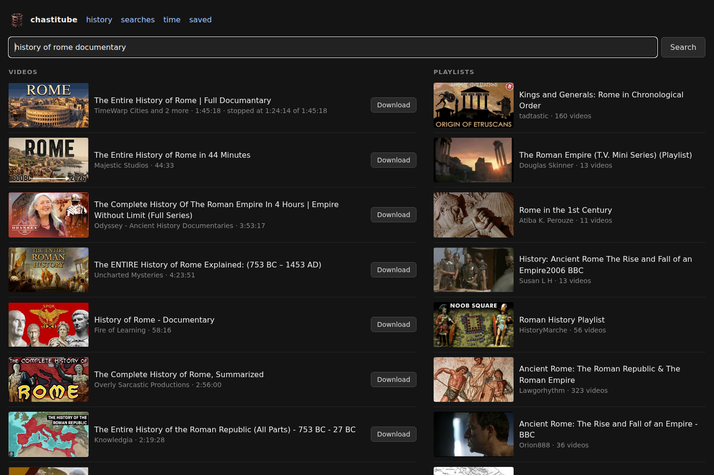
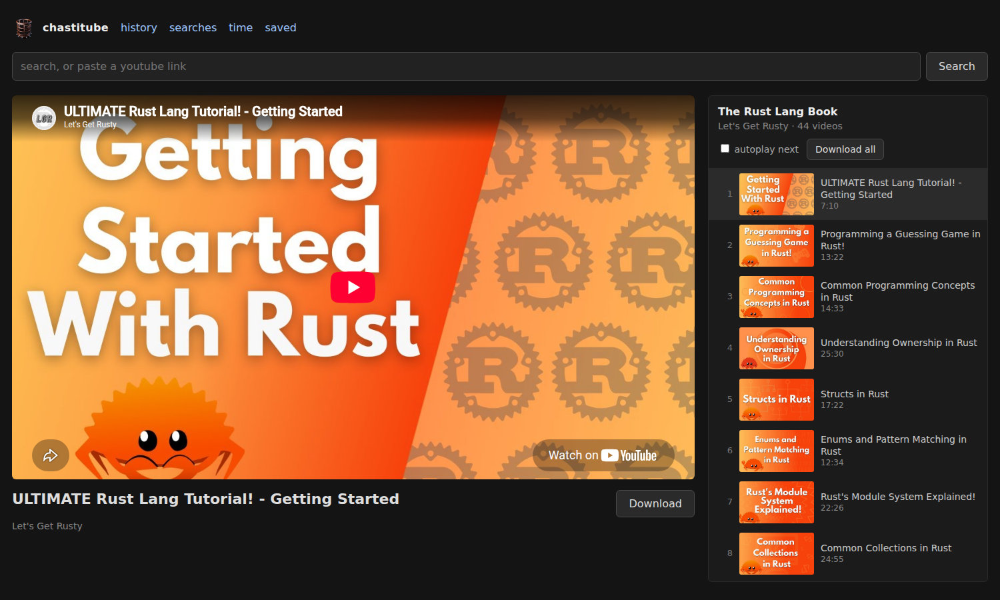
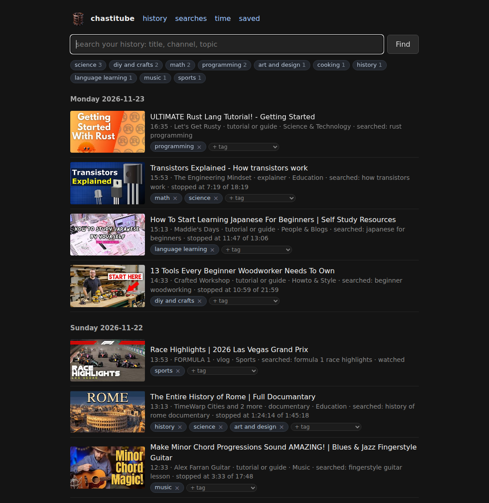
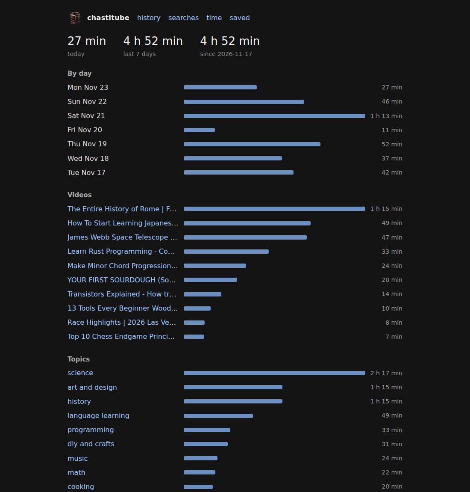

#  chastitube

YouTube with search, videos and playlists, and no feed. It can't fetch the
home page, recommendations or Mixes at all, so there's nothing to switch back on.

It runs on your own computer, at http://chastitube in Firefox. Linux only for now.

- Search shows videos and playlists (no Shorts). You can paste a link too.
- Videos play in YouTube's embedded player. When a video ends, the player is
  removed, so YouTube can't suggest another one.
- Playlists open beside the player, with Next and an autoplay option.
- It remembers where you stopped in each video.
- History, past searches, and how long you've actually watched, by day, video
  and channel.
- Download saves a video (or a whole playlist) to `~/Videos/chastitube`, and
  then it plays from disk.
- YouTube links you click in other apps (Discord etc.) open in chastitube.
  Every other link goes to Firefox.

## Install

You need Rust (`cargo`) and Firefox.

    git clone https://github.com/wegfawefgawefg/chastitube
    cd chastitube
    ./install.sh

That builds it, starts it, starts it again at every login, and makes it the
handler for links you click in other apps. Then:

- `chube` (from dmenu or a terminal) opens it.
- http://localhost:8790 works in any browser.
- For http://chastitube, so you can just type `chastitube` in Firefox, run
  `./install.sh --name` once. It asks for sudo to add `chastitube` to
  `/etc/hosts` on its own loopback address (127.0.0.73, so port 80 there
  can't clash with anything you run on localhost), to let normal programs use
  ports below 1024 (`/etc/sysctl.d/60-chastitube.conf`), and to tell Firefox
  that the word `chastitube` is a site, not a search (its policy file). Restart
  Firefox after.

Run `./install.sh` again after changing the code. `./install.sh --uninstall`
makes links go straight to Firefox again.

To block YouTube itself in Firefox (but keep embedded videos working), copy
`firefox/policies.json` to `/etc/firefox/policies/policies.json` (needs sudo,
then restart Firefox). Without this, nothing stops you opening youtube.com.

Your data (history, searches, resume points, watch time) is in
`~/.local/share/chastitube/`. It only talks to YouTube, and to GitHub to
update yt-dlp, which it uses for downloads.

## Topic tags (optional, off by default)

    ./install.sh --tags       # build the tagger and download its model (1.7 GB)
    ./install.sh --tags-off   # turn them off again

Each video you open gets topic tags (games, math, cooking...) and a kind
(lecture, tutorial, playthrough...), shown on the history page. Click a tag to
see everything with it, click x to remove a wrong one, or add one. Your fixes
always win. The time page shows time per topic.

The topics are in `~/.local/share/chastitube/topics.txt`, one per line
(`name: what it covers`); edit them freely. Each topic is one more question
per video.

The tags come from [Laya](https://huggingface.co/convaiinnovations/laya)
(Apache 2.0, by Convai Innovations), a model that answers questions about
text, run on the CPU through ONNX Runtime using
[desplega's ONNX export](https://huggingface.co/desplega/laya-onnx). The
tagger (`bin/chastitube-tagger`, code in `tagger/`) starts at the lowest
priority when there's a new video, uses 4 threads and about 2.4 GB of RAM
for a few seconds per video, then exits. Nothing leaves your computer.

## Code

One Rust program, `bin/chastitube`: `serve` is the web server, `open URL` is
the link handler, and on its own it opens the page. Code is in `src/`.
YouTube's API is in `youtube.rs`, the pages are in `pages.rs` and `player.rs`,
and the saved data is in `store.rs`.

The screenshots are from a demo setup, not anyone's real history.
